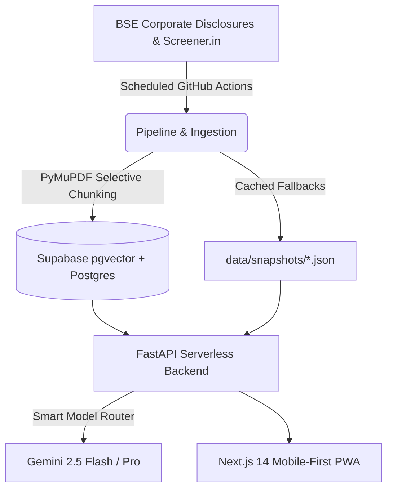

# FINN — Financial Investment Agent

> A mobile-first financial investment agent for Indian equity investors, built for the **ENAM Holdings AI Engineer Build Challenge**.

## Live Demo
- **URL**: Deployed on Vercel
- **Interactive UI**: Mobile-optimized (390px viewport container for desktop inspection)

---

## The Core Thesis
**An investor's day starts with a 60-second brief, not an unranked dashboard.**
FINN discards "AI slop" and noisy broker commentary. It operates strictly across two modes:
1. **Push Intelligence**: Proactively scores and filters SEBI filings by materiality, delivering structured results cards and executive transition bios.
2. **Pull Research**: Answers ad-hoc equity questions strictly grounded in primary sources (Annual Reports, Concall Transcripts, Screener.in balance sheet tables) with verbatim quotes and verifiable page citations.

---

## Flagship Features
1. **Promised vs. Delivered Scorecard**: Evaluates historic earnings concall transcripts to extract explicit management guidance on growth, EBITDA margins, and capex, auditing them against subsequent audited financials to produce a quantified Credibility Score (e.g. 8/10).
2. **Rich Quarterly Disclosures**: Extracts Revenue, EBITDA/NII, PBT, and PAT across YoY and QoQ comparisons with EBITDA margin changes in basis points.
3. **Threshold Triggers & Correlated 'Why it moved'**: Correlates volume spikes and price breakouts with corporate filings filed within the same window.

---

## Architecture & Data Flow



---

## Smart Model Routing & Cost Efficiency

| Task | Model Used | Reason | Typical Cost |
|---|---|---|---|
| Filing Classification | Rule-based Engine | Zero-cost regex & BSE category mapping | ₹0.00 |
| Ambiguous Filings & One-liners | Gemini 2.5 Flash | High-speed structured JSON parsing | ≈ ₹0.005 / call |
| Results & Management Extraction | Gemini 2.5 Flash | Strict JSON schema extraction | ≈ ₹0.012 / call |
| Promised vs Delivered Synthesis | Gemini 2.5 Pro | Deep reasoning, reconciling claims vs numbers | ≈ ₹0.75 / synthesis |
| Embeddings | Gemini Embedding-001 | Hybrid search (pgvector + tsvector) | Negligible |

Every LLM generation is SHA-256 cached in `llm_cache` to guarantee no duplicate token spend.

---

## Local Setup

### 1. Requirements
- Node.js 18+
- Python 3.10+

### 2. Frontend & Backend
```bash
# Install frontend dependencies
npm install

# Install API dependencies
pip install -r requirements.txt

# Run Next.js frontend
npm run dev
```

For running the API locally:
```bash
uvicorn api.index:app --reload --port 8000
```

