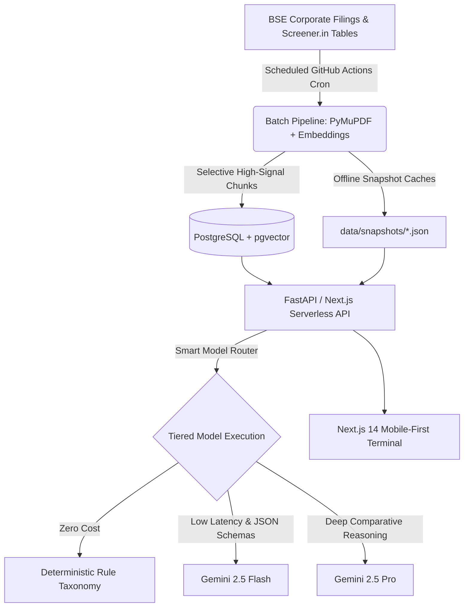

# FINN — Financial Investment Agent

> A mobile-first financial investment agent for Indian equity investors, built for the **ENAM Holdings AI Engineer Build Challenge**.

[](https://finn-assigbnment-1f4bztefw-vaibhav-guptas-projects-b910ed08.vercel.app/brief)
[](https://github.com/gvaibhav2023/FINN-ENAM-HOLDINGS)

---

## 📱 Live Demo
- **Production Web App**: [https://finn-assigbnment-1f4bztefw-vaibhav-guptas-projects-b910ed08.vercel.app/brief](https://finn-assigbnment-1f4bztefw-vaibhav-guptas-projects-b910ed08.vercel.app/brief)
- **Viewport**: Mobile-first design (calm institutional finance terminal centered within a 430px frame for desktop inspection).

---

## 💡 The Core Thesis
**An investor's day starts with a 60-second brief, not an unranked dashboard.**

FINN rejects "AI slop" (unformatted markdown hallucinations, generic chat templates) in favor of high-density financial presentation and auditability. It operates strictly across two interaction modalities:

1. **Push Intelligence (Proactive)**: Proactively filters and scores daily corporate exchange filings (BSE/NSE), delivering structured quarterly earnings cards with YoY/QoQ comparisons, C-suite executive transition profiles, and configurable anomaly alerts with correlated *"Why it moved"* links.
2. **Pull Research (On-Demand & Grounded)**: Answers equity queries grounded **strictly in primary sources** (Annual Reports, Concall Transcripts, and Screener.in primary financial statements). No broker notes, no secondary news commentary, and no LLM open-web hallucinations.

---

## 🌟 Flagship Features

### 1. Promised vs. Delivered Audit Scorecard ⭐ (Pull Flagship)
- Ingests the last 4 concall transcripts and uses **Gemini 2.5 Flash** to extract quantitative forward guidance:
  $$\{\text{metric}, \text{target}, \text{timeframe}, \text{verbatim quote} \le 25 \text{ words}, \text{page citation}\}$$
- Automatically reconciles those promises against subsequent audited financials from later quarters.
- **Gemini 2.5 Pro** synthesizes objective categorical verdicts (`Delivered ✅`, `Partial 🟡`, `Missed ❌`, `Too Early ⏳`), an **Executive Credibility Score** (e.g., `8/10 Met`), and a concise divergence analysis highlighting where narrative and numbers detached.

### 2. Rich Corporate Announcement Cards (Push Flagship)
- **Results Card**: Extracts Revenue, EBITDA/NII, PBT, and PAT across YoY and QoQ horizons. For banks/NBFCs (e.g., HDFC Bank, Bajaj Finance), automatically swaps EBITDA for Net Interest Income (NII) and Operating Profit. Features a 4-row mini table with colored delta indicators and margin comments.
- **Management Changes**: Extracts appointment/resignation details from SEBI regulatory filings, paired with executive background profiles highlighting prior tenure and domain expertise.
- **Collapsed Routine Filings**: Routine administrative disclosures (ESOP allotments, trading window closures, certificate filings) are mathematically deprioritized into compact collapsible counters.

### 3. Configurable Anomaly Triggers & "Why It Moved"
- Evaluates end-of-day price moves against customizable thresholds:
  - **Volume Spike**: Current volume $> N \times$ 20-day trailing average volume.
  - **Price Move**: Single-day price movement beyond $\pm X\%$.
- Correlates triggered alerts with corporate filings published within the same 24–48h window to immediately answer *"Why it moved"*.

---

## 🏗 Architecture & System Design



---

## ⚡ Smart Model Routing & Cost Optimization

| Task | Engine / Model | Rationale | Cost / Run |
|---|---|---|---|
| **Filing Classification** | Rule-Based Regex Taxonomy | Deterministic regex categorizes 85% of routine filings without invoking an LLM. | **₹0.00** |
| **Ambiguous Announcements & One-Liners** | Gemini 2.5 Flash | High-speed structured JSON parsing enforcing $\le 18$-word factual summaries. | **~₹0.005** |
| **Results & Management Extraction** | Gemini 2.5 Flash | Strict JSON schema extraction for structured 4-row comparative tables. | **~₹0.012** |
| **Promised vs. Delivered Synthesis** | Gemini 2.5 Pro | Deep reasoning reconciling historical transcripts against audited financials. | **~₹0.75** |
| **Hybrid Document Retrieval** | Gemini Embeddings + tsvector | Selective embedding of high-signal AR sections (MD&A, Auditor Notes, Segments). | **~₹0.001** |

> Every prompt invocation is hashed (`sha256(model + prompt)`) and stored in `llm_cache` to ensure zero redundant token consumption.

---

## 📂 Repository Structure

```
.
├── app/
│   ├── (tabs)/
│   │   ├── brief/            # Push: windowed digest feed (home)
│   │   ├── alerts/           # Push: triggered alerts + threshold settings sheet
│   │   ├── ask/              # Pull: primary source ticker research desk
│   │   └── portfolio/        # Holdings: 18 stocks, day deltas, unread filing badges
│   ├── api/                  # Native Next.js API Route Handlers
│   ├── company/[symbol]/     # Horizontally scrollable research desk & citations
│   ├── layout.tsx            # Mobile shell container (max-w 430px)
│   └── globals.css           # Tailwind custom terminal theme (#0B0D10)
├── api/
│   ├── index.py              # FastAPI application for serverless deployment
│   └── core/                 # DB connectors, Gemini model router, SHA-256 caching
├── pipeline/
│   ├── refresh_prices.py     # EOD daily OHLCV ingestion via yfinance
│   ├── fetch_announcements.py# BSE announcement fetcher with backoff
│   └── requirements.txt      # Pipeline-specific heavy packages (PyMuPDF, etc.)
├── data/
│   ├── portfolio.json        # 18 demo portfolio holdings + 4 watchlist stocks
│   ├── taxonomy.json         # Priority weights & keyword mappings
│   ├── bse_scrip_map.json    # NSE ticker to BSE code master map
│   └── snapshots/            # Fallback JSON snapshots for offline evaluation
├── db/
│   └── schema.sql            # PostgreSQL schema with pgvector & tsvector
├── .github/workflows/
│   └── daily_refresh.yml     # Automated Mon–Fri cron data pipeline
└── vercel.json               # Serverless rewrite configuration
```

---

## 🛠 Local Setup & Development

### Prerequisites
- Node.js 18+
- Python 3.10+

### Installation & Run
```bash
# 1. Clone the repository
git clone https://github.com/gvaibhav2023/FINN-ENAM-HOLDINGS.git
cd FINN-ENAM-HOLDINGS

# 2. Install frontend dependencies
npm install

# 3. Configure environment variables (optional for local mock mode)
cp .env.example .env.local

# 4. Start Next.js development server
npm run dev
```

Visit [http://localhost:3000](http://localhost:3000) to view the application.

---

## 🎯 Evaluator Notes
- **Resilience**: Every endpoint incorporates automatic snapshot fallbacks (`data/snapshots/`), guaranteeing the app never presents empty or broken views during offline reviews.
- **PWA Support**: Built with installable Web App manifest and icon assets.
- **Generalization**: The research engine is not hardcoded to the demo universe; arbitrary NSE tickers can be initiated on demand via bounded stepwise job processing.
